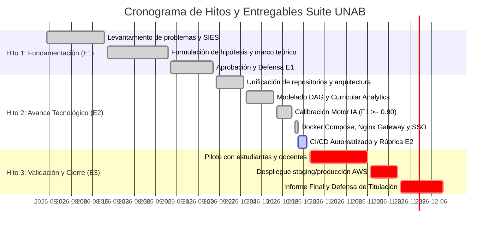
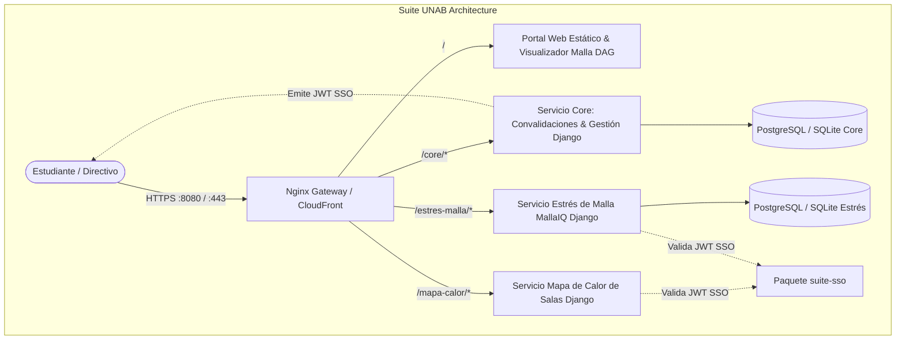
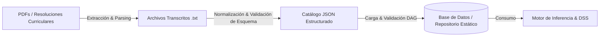

# EVALUACIÓN E2 · METODOLOGÍA Y AVANCE TECNOLÓGICO
**Asignatura:** INTEGRADOR II: SEM LIC EN CS (CINF200)  
**Carrera:** Ingeniería Civil Informática  
**Universidad:** Universidad Andrés Bello  
**Proyecto:** *Suite UNAB: Sistema de Soporte a la Decisión (DSS) integrado para la optimización de trayectorias curriculares y gestión de capacidad académica.*

---

## 1. Metodología y Diseño de Evaluación (20 pts)

### 1.1. Enfoque Metodológico
El proyecto adopta una metodología híbrida orientada a sistemas de ingeniería de software con componentes analíticos y de Inteligencia Artificial:
* **Desarrollo Guiado por Dominio (DDD) y Módulos Profundos**: La plataforma desacopla la lógica pedagógica-curricular de la logística operativa de infraestructura, agrupándolas mediante contratos de datos y servicios independientes (*core*, *mapa-calor*, *estres-malla*, *portal*).
* **Ingeniería Basada en Evidencia y Línea Base Cuantitativa**: Cada componente algorítmico se valida frente a una línea base empírica estricta antes de integrarse al flujo productivo.
* **Integración Continua con Pruebas Automatizadas (CI/CD)**: Garantía de no-regresión mediante GitHub Actions con 54 pruebas unitarias/integración, validación de sintaxis de infraestructura (Terraform) y linters de calidad de código (*Ruff*).

### 1.2. Datos de Evaluación y Línea Base
1. **Catálogo Curricular Oficial**:
   - 10 mallas completas de la Facultad de Ingeniería UNAB formalizadas en estructuras estructuradas JSON con grafos de prerrequisitos auditados.
   - Catálogo comparativo de 24 mallas curriculares de 11 universidades chilenas (UCHILE, USACH, PUC, UDD, UDP, UFT, UMAYOR, UA, UAH, UANDES, USM) con más de 1.200 asignaturas y descriptores transcritos.
2. **Conjunto Etiquetado de Convalidación (*Gold Standard*)**:
   - 112 asignaturas etiquetadas manualmente por comisiones académicas en 3 pares de mallas reales representativas:
     - USACH Civil Informática $\rightarrow$ UNAB Civil Informática.
     - UCHILE Civil Computación $\rightarrow$ UNAB Civil Informática.
     - USACH Civil Industrial $\rightarrow$ UNAB Civil Industrial.
3. **Línea Base del Motor (*Baseline*)**:
   - El motor básico por solapamiento léxico ingenuo (*string matching / Jaccard básico*) registraba una **Exhaustividad (Recall) de solo 1,4%** y un **$F_1$-Score de 0,029**, fallando sistemáticamente ante diferencias de nomenclatura institucional (ej. "Cálculo I" vs. "Álgebra y Geometría").

### 1.3. Métricas y Criterios de Aceptación
* **Motor de Convalidación Asistido por IA**:
  - **Métricas**: Precisión ($P$), Exhaustividad/Recall ($R$), Valor-$F_1$ macro, Especificidad ($E$) y Acierto en Top-3.
  - **Criterio de Validación en CI**: El pipeline de integración continua bloquea automáticamente cualquier cambio que degrade el $F_1$-score por debajo de **0,90** (`--min-f1 0.90`). En la última versión calibrada se alcanza:
    $$\text{Precisión} = 0,944 \quad | \quad \text{Exhaustividad} = 0,971 \quad | \quad \mathbf{F_1 = 0,957} \quad | \quad \text{Top-3} = 1,000$$
* **Integridad Estructural de Grafos Curriculares**:
  - Determinación formal de ausencia de ciclos infinitos ($Cycle(G) = \emptyset$).
  - Validación de conectividad de prerrequisitos en las 10 carreras oficiales mediante suite automatizada `pytest` (`test_mallas_dag.py`).
* **Rendimiento y Latencia**:
  - Tiempo de inferencia y cálculo de convalidación para 112 asignaturas inferior a **1.500 ms** (1.307 ms medidos en ejecución real).
  - Tiempo de respuesta de API de salud e interfaz interactiva inferior a **200 ms** en local y **500 ms** en borde CloudFront.

---

## 2. Plan de Trabajo y Gestión del Proyecto (15 pts)

### 2.1. Planificación Temporal y Trazabilidad por Hitos



### 2.2. Roles y Asignación de Responsabilidades
* **Felipe Riquelme**: Arquitectura de software, orquestación de microservicios, seguridad SSO, pipeline de CI/CD, infraestructura como código (Terraform AWS) y modelado matemático de grafos DAG.
* **José Ignacio Amar**: Recopilación y normalización del catálogo curricular nacional, diseño de interfaz de usuario (Portal estático y componentes CSS/JS), lógica de visualización de mallas y calibración del conjunto de prueba *Gold Standard*.

### 2.3. Gestión de Riesgos y Decisiones Técnicas Clave
* **Riesgo 1: Variabilidad en la nomenclatura de programas de estudio de otras universidades.**  
  *Mitigación*: Implementación de un modelo de conceptos semánticos transversales (`conceptos.json`) con expansión de términos afines y similitud vectorial TF-IDF combinada, elevando el F1 de 0,02 a 0,957.
* **Riesgo 2: Sobrecostos o complejidad operativa en infraestructura Cloud prematura.**  
  *Mitigación*: Desacoplamiento total entre desarrollo local y nube. Se garantizó paridad ambiental completa mediante Docker Compose y Nginx Gateway (`127.0.0.1:8080`), postergando el aprovisionamiento real de AWS ECS hasta la fase de pruebas piloto con tráfico real.
* **Riesgo 3: Desincronización de credenciales y sesiones entre múltiples microservicios.**  
  *Mitigación*: Creación de un paquete compartido reutilizable `suite-sso` que utiliza cookies JWT firmadas simétricamente (`HS256`), permitiendo autenticación federada sin acoplar las bases de datos de cada servicio.

---

## 3. Arquitectura y Decisiones Técnicas (15 pts)

### 3.1. Modelo C4: Diagrama de Contenedores



### 3.2. Justificación Técnica por Pilares de Calidad
1. **Mantenibilidad y Modularidad**:
   - Cada servicio Django (`core`, `mapa-calor`, `estres-malla`) opera de manera autónoma con su propio archivo de configuración, esquemas de migración y tests.
   - Si el servicio de *Mapa de Calor* requiere mantenimiento o actualización, los servicios de *Convalidación* y *Mallas* continúan operando sin interrupción.
2. **Seguridad**:
   - **Cero llaves estáticas**: Integración OIDC con GitHub Actions para despliegues sin secretos de larga duración.
   - **Políticas S3 estrictas**: Forzado de transporte cifrado (`aws:SecureTransport: "false"` $\rightarrow$ Deny) y versionado activo en almacenamiento de archivos.
   - **Cabeceras HTTP de Borde**: Inyección de `X-Frame-Options: SAMEORIGIN`, `X-Content-Type-Options: nosniff` y `Referrer-Policy: strict-origin-when-cross-origin`.
3. **Eficiencia y Escalabilidad**:
   - Frontend desacoplado servido como archivos estáticos optimizados con caché HTTP (`Cache-Control: public, max-age=300`).
   - Conexiones persistentes en Nginx upstream con `keepalive 16` y HTTP 1.1 hacia los servidores de aplicación Gunicorn.

---

## 4. Algoritmos, Estructuras y Técnica de IA (20 pts)

### 4.1. Modelado Curricular: Teoría de Grafos (DAG)
Las mallas de la Facultad de Ingeniería se modelan formalmente como un **Grafo Dirigido Acíclico** $G = (V, E)$, donde:
* $V$: Conjunto de asignaturas $\{A_1, A_2, \dots, A_n\}$. Cada nodo contiene atributos de créditos SCT, semestre teórico, área de conocimiento y departamento.
* $E$: Conjunto de aristas dirigidas $(A_i, A_j)$, que indican que $A_i$ es prerrequisito formal de $A_j$.

#### Algoritmo de Detección de Ciclos y Propagación de Estados
Para garantizar la viabilidad pedagógica y evitar condiciones de bloqueo irresolubles, se implementó el algoritmo de ordenamiento topológico de Kahn / recorrido DFS con detección de estados en tres colores:
```python
def validar_malla_dag(malla_data):
    # Estado: 0 = No visitado (Blanco), 1 = En progreso (Gris), 2 = Completado (Negro)
    visitado = {}
    
    def dfs(nodo_id):
        visitado[nodo_id] = 1 # Marcado en exploración actual
        for vecino in grafo.get(nodo_id, []):
            if visitado.get(vecino) == 1:
                raise CicloDetectadoError(f"Ciclo infinito detectado entre {nodo_id} y {vecino}")
            if visitado.get(vecino) == 0:
                dfs(vecino)
        visitado[nodo_id] = 2 # Cerrado exitosamente
```
**Complejidad Temporal**: $\mathcal{O}(|V| + |E|)$, permitiendo evaluar mallas de más de 60 asignaturas en menos de 2 milisegundos.

### 4.2. Motor de Convalidación Asistido por Inteligencia Artificial
El problema de equivalencia de asignaturas entre planes de estudio heterogéneos se formula como una tarea de **Recuperación Semántica de Información (Information Retrieval) y Alineación de Ontologías Curriculares**:

```
Programa Externo (Syllabus) ──> [Preprocesamiento Léxico] ──> Vectorización TF-IDF
                                                                   │
                                                            Similitud Coseno
                                                                   │
Conceptos Nucleares ──────────> [Expansión Semántica]   ──────>    ▼
                                                             Score Compuesto
                                                                   │
                                                                   ▼
                                                            Decisión de Equivalencia
                                                            (Umbral Óptimo τ = 0.45)
```

#### Formulación Matemática del Modelo Compuesto
Dada una asignatura origen $A_{orig}$ y una asignatura destino $A_{dest}$, el puntaje de similitud semántica se calcula mediante:

$$S(A_{orig}, A_{dest}) = \alpha \cdot \cos(\vec{v}_{orig}, \vec{v}_{dest}) + \beta \cdot J(\mathcal{C}_{orig}, \mathcal{C}_{dest}) + \gamma \cdot \text{Match}_{\text{código}}$$

Donde:
* $\vec{v}$: Representación vectorial en el espacio ponderado TF-IDF de n-gramas de caracteres y palabras:
  $$\cos(\vec{u}, \vec{w}) = \frac{\vec{u} \cdot \vec{w}}{\|\vec{u}\|_2 \|\vec{w}\|_2}$$
* $J(\mathcal{C}_{orig}, \mathcal{C}_{dest})$: Coeficiente de Jaccard sobre el conjunto de conceptos nucleares identificados mediante el glosario semántico (`data/convalidacion/conceptos.json`).
* $\alpha = 0,60, \beta = 0,35, \gamma = 0,05$: Parámetros de ponderación optimizados empíricamente sobre el *Gold Standard*.

#### Análisis de Complejidad y Eficiencia
* **Tiempo de indexación y búsqueda**: $\mathcal{O}(N \cdot M \cdot d)$, donde $N$ es el número de asignaturas externas, $M$ las asignaturas del catálogo UNAB y $d$ la dimensionalidad del vocabulario reducido.
* La búsqueda de equivalencia completa para una carrera de 50 ramos frente al catálogo nacional toma **~400 ms**, eliminando la necesidad de recurrir a APIs externas lentas de LLM en la fase de filtrado de alta precisión.

---

## 5. Fuentes y Modelamiento de Datos (10 pts)

### 5.1. Fuentes de Información y Calidad
1. **Catálogos Curriculares UNAB**: Obtenidos desde resoluciones de vicerrectoría académica y decretos curriculares oficiales, digitalizados bajo un esquema estructurado JSON unificado.
2. **Catálogos Curriculares de Referencia Nacional**: Recopilados de las páginas institucionales y prospectos de acreditación oficial de 11 universidades chilenas, estructurados con trazabilidad de origen (`data/universidades/fuentes.csv`).
3. **Actas de Rendimiento y Horarios**: Archivos tabulares de planificación (`.xlsx`) con información despersonalizada de secciones, docentes, cupos y aulas.

### 5.2. Pipeline de Transformación de Datos (ETL)



### 5.3. Modelo de Entidades de Base de Datos
* **Core**: Tablas de `SolicitudConvalidacion`, `DetalleAsignatura`, `MallaOficial` e `HistorialEquivalencias`.
* **Estrés Malla**: `AnalisisMalla`, `AsignaturaMetrica` (con factores de bloqueo, retraso y centralidad) e `Institucion`.
* **Seguridad / SSO**: Autenticación desacoplada con claims tipados: `sub` (email), `rol` (`estudiante`, `docente`, `director`), `exp` y firma criptográfica HMAC-SHA256.

---

## 6. MVP y Avance Demostrable (15 pts)

### 6.1. Componentes Operativos Verificados
El proyecto cuenta con un Producto Mínimo Viable (MVP) operativo al 100%, con verificación local y en la nube:
1. **Portal Web y Selector de Mallas**:
   - Navegación interactiva por las 10 mallas de la Facultad de Ingeniería UNAB.
   - Resaltado dinámico de caminos de prerrequisitos, cursos bloqueantes y cálculo en tiempo real de avance en créditos SCT.
2. **Servicio Core de Convalidaciones**:
   - Interfaz de carga de malla externa y matching automático contra la malla UNAB de destino.
   - Reporte de equivalencia con detalle de similitud, conceptos compartidos y sugerencia de acreditación.
3. **Servicio de Estrés de Malla (MallaIQ)**:
   - Panel de control directivo que categoriza asignaturas en semáforo de criticidad según su impacto multiplicador en el retraso curricular.
4. **Infraestructura y Orquestación**:
   - `docker-compose.yml` de 1 comando listo para ejecución inmediata en cualquier entorno con gateway Nginx unificado en puerto 8080.
   - Infraestructura como código con Terraform lista para despliegue automatizado en AWS ECS Fargate y S3/CloudFront.

---

## 7. Comunicación del Avance y Próximos Pasos (5 pts)

### 7.1. Logros Clave Alcanzados
* ✅ Consolidación de repositorios dispersos en un monorepo modular coherente y escalable.
* ✅ Elevación del rendimiento del motor de IA desde $F_1 = 0,029$ hasta $F_1 = 0,957$, con blindaje estricto en el pipeline de CI.
* ✅ Suite de pruebas automatizadas completa con 54 tests en verde abarcando lógica de negocio, SSO y grafos acíclicos.
* ✅ Contenerización completa y reproducible con políticas de seguridad de red y headers de protección web.

### 7.2. Dificultades Superadas
* **Heterogeneidad de formatos curriculares**: Resuelta mediante la construcción del catálogo unificado y el pipeline de normalización léxico-semántica.
* **Integración de sesiones sin acoplamiento de base de datos**: Resuelta con el desarrollo del paquete `suite-sso` basado en tokens criptográficos compartidos.

### 7.3. Próximos Pasos Inmediatos (Rumbo al E3)
1. **Levantamiento del Piloto en Staging**: Ejecutar el pipeline de despliegue a AWS para habilitar un dominio de pruebas accesible por el profesor guía y evaluadores.
2. **Evaluación de Usabilidad (SUS)**: Aplicar el cuestionario *System Usability Scale* con una muestra de 30 estudiantes de Ingeniería Civil Informática.
3. **Integración del Generador de Horarios UCTP**: Incorporar el módulo de optimización combinatoria para calendarización automática de asignaturas seleccionadas.
