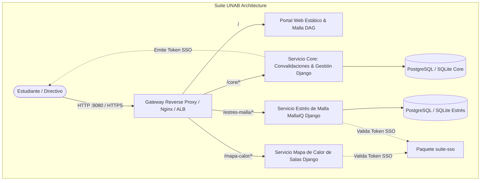
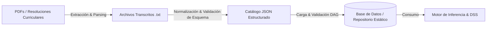

# UNIVERSIDAD ANDRÉS BELLO
**Facultad de Ingeniería · Escuela de Tecnologías de la Información**  
**Carrera de Ingeniería Civil Informática**  
**Asignatura:** INTEGRADOR II: SEM LIC EN CS (CINF200)  
**Semestre:** Segundo Semestre 2026  

---

# INFORME DE MEMORIA Y PROYECTO DE TÍTULO
## *Suite UNAB: Sistema de Soporte a la Decisión (DSS) Integrado para la Optimización de Trayectorias Curriculares y Gestión de Capacidad Académica*

**Documento Consolidado:** Evaluación E1 (Formulación y Fundamentación) + Evaluación E2 (Metodología y Avance Tecnológico)  
**Estudiantes:** Felipe Riquelme Salvo · José Ignacio Amar  
**Profesor Guía:** Comisión de Titulación Facultad de Ingeniería  
**Fecha:** Noviembre de 2026  

---

# PARTE I · FORMULACIÓN Y FUNDAMENTACIÓN DEL PROYECTO (ENTREGA E1)

## 1. Diagnóstico y Contexto

El proceso formativo en la educación superior chilena, particularmente en las carreras de ingeniería civil, enfrenta un desafío estructural histórico relacionado con la deserción, el retraso académico acumulativo y la sobreduración de los planes de estudio.

### 1.1. Evidencia Cuantitativa Oficial (Datos SIES - Mineduc)
De acuerdo con las estadísticas oficiales del **Servicio de Información de Educación Superior (SIES)** del Ministerio de Educación de Chile en su informe sobre *Duración Real y en Exceso de Carreras de Pregrado*:
* La carrera de **Ingeniería Civil en Computación e Informática** registra una **duración real promedio de 13,8 semestres**, frente a una duración formal nominal de 10 a 11 semestres.
* Esto representa una **sobreduración media de 2,91 semestres** (prácticamente un año y medio de permanencia adicional por cada egresado).
* En programas afines de base tecnológica (Ingeniería en Informática), la duración en exceso promedio asciende a **3,45 semestres**.

### 1.2. Costo Financiero del Abandono y la Sobreduración
La literatura especializada revela que la ineficiencia curricular tiene un impacto financiero devastador:
* En Chile, la deserción estudiantil en primer año genera un costo directo anual estimado entre **128 y 141 millones de dólares** para las instituciones de educación superior.
* Analizado en una ventana formativa de cinco años, la cohorte de estudiantes desertores representa para el sistema una pérdida acumulada superior a **1.100 millones de dólares** en aranceles no percibidos y pérdida de subsidios de gratuidad.
* Para el estudiante y su núcleo familiar, la pérdida de gratuidad o créditos del Estado al sobrepasar la duración nominal genera un sobreendeudamiento forzoso o la desvinculación definitiva en etapas avanzadas de la carrera.

---

## 2. Formulación de la Hipótesis del Proyecto

Tradicionalmente, las instituciones atribuyen el rezago y la deserción a factores intrínsecos del estudiante (brechas de capital cultural, nivel socioeconómico o hábitos de estudio). Sin embargo, este proyecto plantea como tesis central que una fracción crítica de este fenómeno obedece a deficiencias de diseño del sistema:

> **Hipótesis del Proyecto:**  
> *"La deserción universitaria, el retraso académico y la sobreduración de las carreras no obedecen de forma exclusiva a factores individuales o socioeconómicos del estudiante, sino que están significativamente determinados por fallas de diseño y opacidad institucional: la pérdida de avance en las convalidaciones de asignaturas, la presencia de puntos de estrés curricular (prerrequisitos rígidos y cursos cuello de botella) y la ausencia de herramientas tecnológicas de auditoría y planificación (como mallas interactivas).*  
>  
> *Consecuentemente, la carencia de estas herramientas de soporte a la toma de decisiones genera un costo financiero crítico tanto para los estudiantes (agotamiento de beneficios y desvinculación) como para las universidades (ingresos millonarios no devengados por deserción)."*

---

## 3. Fundamentación Teórica y Estado del Arte

La hipótesis formulada encuentra un sólido respaldo empírico en la literatura científica nacional e internacional:

### 3.1. Convalidación y Pérdida de Avance Curricular
* En procesos de transferencia y admisión especial, los estudiantes pierden en promedio entre el **34% y el 43%** de los créditos aprobados con anterioridad debido a revisiones lentas, manuales y discrecionales.
* La evidencia empírica demuestra que aquellos estudiantes que logran convalidar $\ge 90\%$ de sus asignaturas previas tienen **2,5 veces más probabilidades de graduarse** ($Odds\ Ratio = 2,5$) en comparación con aquellos que pierden más de la mitad de su carga académica anterior.

### 3.2. Puntos de Estrés Curricular (*Curricular Analytics*)
* Mediante la modelación de planes de estudio como Grafos Dirigidos Acíclicos ($G = (V, E)$), el marco de *Curricular Analytics* (Heileman et al.) formalizó que las asignaturas con un alto **Factor de Bloqueo ($b$)** (número de materias subsecuentes que dependen de ella) y un alto **Factor de Retraso ($d$)** (longitud del camino crítico más largo) estrangulan la progresión estudiantil.
* Un incremento de 20 puntos en la complejidad estructural de una malla curricular reduce en un **3,74%** la probabilidad de graduación a tiempo.
* En el contexto nacional chileno, **Salazar-Fernández et al. (2021)** demostraron empíricamente que el **76,21% de los estudiantes que desertan tardíamente** lo hacen adeudando ramos calificados formalmente como "cuellos de botella", tras una permanencia improductiva promedio de casi 9 semestres.

### 3.3. Impacto de las Herramientas de Auditoría (*Degree Audit*) y Mallas Interactivas
* Estudios en instituciones universitarias evidencian que la adopción de plataformas de auditoría de avance (*Degree Audit*) y trayectorias guiadas incrementa la titulación oportuna en **17 puntos porcentuales**.
* Simultáneamente, reduce la proporción de graduados con créditos sobrantes o improductivos desde un **30% a tan solo un 5%**.

### 3.4. Comparativa con Soluciones Existentes

| Paradigma | Ejemplos | Fortalezas | Limitaciones frente al enfoque Suite UNAB |
|---|---|---|---|
| **Sistemas ERP Institucionales** | Banner (Ellucian), PeopleSoft, SAP | Centralización de registros oficiales, actas y notas consolidadas. | Interfaces rígidas, poca usabilidad, nula simulación de escenarios (*what-if*), incapacidad de proyectar demanda de salas. |
| **Plataformas LMS** | Canvas, Blackboard, Moodle | Gestión de cursos, tareas y comunicación de aula. | Centrados exclusivamente en la asignatura individual; no visualizan la trayectoria curricular completa ni optimizan horarios. |
| **Iniciativas Estudiantiles Ad-hoc** | Scripts en GitHub, simuladores no oficiales | Ágiles para armar horarios puntuales. | Sin respaldo institucional, vulnerables al abandono, sin integración con datos oficiales y sin arquitectura de seguridad. |
| **Modelos de IA Aislados** | Consultas a ChatGPT o Claude | Análisis de lenguaje natural para comparar textos. | Desconectados del catálogo curricular oficial, propensos a alucinaciones sin supervisión y sin persistencia de datos. |

---

## 4. Definición de la Solución: Arquitectura Suite DSS Académica

Actualmente, las herramientas diseñadas para asistir al estudiante y a la gestión académica en la facultad existen de manera **desarticulada, heterogénea y fragmentada**, operando como islas tecnológicas.

### 4.1. El Concepto de Sistema de Soporte a la Decisión (DSS) en Ciclo Cerrado
Frente a esta dispersión, **Suite UNAB** se diseña como un **Sistema de Soporte a la Decisión (DSS)** que opera en un **ciclo cerrado de retroalimentación**, unificando la *Gestión Curricular* (Demanda Pedagógica) con la *Gestión de Capacidad* (Oferta Operativa del Campus):

```
                   ┌───────────────────────────────────────────┐
                   │               SUITE UNAB                  │
                   │        (Orquestador y Gateway)            │
                   └─────────────────────┬─────────────────────┘
                                         │
            ┌────────────────────────────┴───────────────────────────┐
            ▼                                                        ▼
  [ DEMANDA CURRICULAR ]                                   [ OFERTA OPERATIVA ]
  1. Malla Interactiva (DAG)                               4. Mapa de Calor de Salas
     - Trayectoria y what-if                                  - Detección de sobrecupo/ociosidad
  2. Estrés de Malla (MallaIQ)                             5. Generador de Horarios (UCTP)
     - Detección de cuellos de botella                        - Asignación libre de choques
  3. Convalidaciones con IA                                  - Minimización de ventanas
     - Cruce de syllabi de transferencias
            │                                                        ▲
            └──────────────────── Feedback Continuo ─────────────────┘
                   (Proyección de vacantes vs. Capacidad física)
```

### 4.2. Matriz de Módulos de la Suite

| Módulo | Enfoque Técnico | Problema que Resuelve |
| :--- | :--- | :--- |
| **1. Malla Interactiva** | Teoría de Grafos (DAG), recorrido recursivo BFS/DFS, simulación *what-if*. | Opacidad en la trayectoria del alumno, toma desinformada de asignaturas y rezago accidental. |
| **2. Estrés de Malla (MallaIQ)** | *Curricular Analytics* (factores de bloqueo, criticidad y atraso por ramo). | Identificación formal de asignaturas filtro y riesgo de deserción tardía institucional. |
| **3. Convalidaciones con IA** | Procesamiento de Lenguaje Natural semántico y matching conceptual. | Reducción del dictamen de equivalencia de semanas a minutos, preservando créditos aprobados. |
| **4. Mapa de Calor de Salas** | Analítica espacial matricial de ocupación por campus, edificio y módulo. | Erradicación de salas sobrevendidas y visualización de franjas horarias con capacidad ociosa. |
| **5. Generador de Horarios** | Optimización combinatoria en UCTP (*University Course Timetabling Problem*). | Creación automatizada de combinaciones de horario compatibles, sin topes duros y con ventanas mínimas. |
| **6. El Orquestador Central** | Gateway de proxy inverso unificado en puerto 8080 y autenticación SSO desacoplada. | Conecta la demanda proyectada por la analítica curricular con la oferta logística de cursos y salas. |

---

## 5. Objetivos del Proyecto

### 5.1. Objetivo General
**Diseñar e implementar Suite UNAB**, un Sistema de Soporte a la Decisión (DSS) web modular que integre bajo una arquitectura desacoplada y un puerto público unificado las aplicaciones de apoyo curricular y logístico para la carrera de Ingeniería Civil Informática de la Universidad Andrés Bello —malla interactiva, generador de horarios, mapa de calor de salas, análisis de estrés curricular y convalidación asistida por IA—, desplegada en contenedores e infraestructura Cloud de Amazon Web Services (AWS), con el propósito de mitigar la sobreduración académica, optimizar la asignación de recursos y sentar las bases para una gestión universitaria basada en datos.

### 5.2. Objetivos Específicos
1. **Auditar y formalizar** los modelos de datos, flujos de trabajo y requerimientos operativos de las herramientas preexistentes en la secretaría académica de la carrera.
2. **Diseñar una arquitectura modular unificada** basada en microservicios desacoplados con tokens de diseño transversales (*Design System*), barra compartida (`suite-bar`) y un gateway centralizado con inicio de sesión único (SSO).
3. **Refactorizar y optimizar la lógica algorítmica** de las aplicaciones base, incorporando teoría de grafos para la propagación de requisitos en la malla curricular y modelos de *Curricular Analytics* para el diagnóstico de estrés.
4. **Implementar y calibrar el módulo de convalidaciones asistido por IA**, utilizando procesamiento de lenguaje natural semántico para contrastar descriptores curriculares y programas de asignaturas externas.
5. **Formular el motor de planificación horaria (UCTP)** mediante técnicas de optimización combinatoria que garanticen el cumplimiento de restricciones duras (topes de sección, sala y docente) y minimicen restricciones blandas (ventanas horarias).
6. **Diseñar y automatizar la infraestructura Cloud en AWS** (S3, CloudFront, ECS Fargate, Application Load Balancers) para garantizar alta disponibilidad, aislamiento de procesos y escalamiento de cada módulo.
7. **Validar la plataforma mediante pruebas cuantitativas y evaluación de experiencia de usuario (UX)** con estudiantes y autoridades académicas, contrastando tiempos de resolución de trámites frente a los métodos tradicionales.

---

## 6. Alcance y Estrategia de Mitigación de Riesgos

Para asegurar la culminación exitosa de la memoria de titulación dentro de los plazos académicos establecidos, el proyecto adopta una **estrategia de desacoplamiento operativo y experimental**:

1. **Entregable Principal de Titulación (Track Operativo):**
   * Puesta en marcha de la Suite DSS completa, funcional e integrada en el puerto unificado, con pruebas unitarias y de integración continuas (54 pruebas automatizadas en CI).
   * Evaluación de usabilidad empírica con estudiantes y secretaría académica de la carrera mediante encuesta estandarizada SUS.
2. **Línea de Extensión Científica (Track de Investigación Avanzada):**
   * El estudio comparativo profundo de metaheurísticas avanzadas para el problema UCTP se formula como un marco metodológico modular, permitiendo experimentar con diversas técnicas de optimización sin comprometer la entrega operativa del producto de titulación.

---

## 7. Estructura de la Exposición Oral (Defensa E1)

* **Slide 1 · Portada:** Título del proyecto, alumnos memoristas, profesor guía, institución y fecha.
* **Slide 2 · El Problema Real:** Datos oficiales SIES (13,8 semestres de duración real, 2,91 semestres de exceso) y costo financiero de la deserción (\$1.100M USD en 5 años).
* **Slide 3 · La Hipótesis Central:** La sobreduración como consecuencia de fallas de diseño curricular, cuellos de botella y opacidad en la toma de decisiones.
* **Slide 4 · Evidencia del Estado del Arte:** *Curricular Analytics* (Heileman), Salazar-Fernández (2021) y el impacto del 76,2% en ramos cuello de botella.
* **Slide 5 · La Solución: Suite UNAB:** Concepto de Sistema de Soporte a la Decisión (DSS) en ciclo cerrado (Demanda Pedagógica $\leftrightarrow$ Oferta Logística).
* **Slide 6 · Módulos Curriculares:** Malla Interactiva (Grafos DAG), Estrés de Malla (MallaIQ) y Convalidaciones con IA.
* **Slide 7 · Módulos Logísticos:** Mapa de Calor de Salas y Generador de Horarios (UCTP).
* **Slide 8 · Arquitectura Técnica y Gateway:** Orquestador central, puerto unificado 8080, logging estructurado y despliegue Cloud en AWS.
* **Slide 9 · Metodología y Pruebas:** Plan de trabajo hito a hito y suite de pruebas automatizadas en CI.
* **Slide 10 · Conclusiones y Preguntas:** Impacto esperado en la retención, graduación oportuna y eficiencia operativa de la facultad.

---

# PARTE II · METODOLOGÍA Y AVANCE TECNOLÓGICO (ENTREGA E2)

## 8. Metodología y Diseño de Evaluación

### 8.1. Enfoque Metodológico
El proyecto adopta una metodología híbrida orientada a sistemas de ingeniería de software con componentes analíticos y de Inteligencia Artificial:
* **Desarrollo Guiado por Dominio (DDD) y Módulos Profundos**: La plataforma desacopla la lógica pedagógica-curricular de la logística operativa de infraestructura, agrupándolas mediante contratos de datos y servicios independientes (`core`, `mapa-calor`, `estres-malla`, `portal`).
* **Ingeniería Basada en Evidencia y Línea Base Cuantitativa**: Cada componente algorítmico se valida frente a una línea base empírica estricta antes de integrarse al flujo productivo.
* **Integración Continua con Pruebas Automatizadas (CI/CD)**: Garantía de no-regresión mediante GitHub Actions con **54 pruebas unitarias e integración en verde**, validación de sintaxis de infraestructura (Terraform) y linters de calidad de código (*Ruff*).

### 8.2. Datos de Evaluación y Línea Base
1. **Catálogo Curricular Oficial**:
   * 10 mallas completas de la Facultad de Ingeniería UNAB formalizadas en estructuras estructuradas JSON con grafos de prerrequisitos auditados.
   * Catálogo comparativo de 24 mallas curriculares de 11 universidades chilenas (UCHILE, USACH, PUC, UDD, UDP, UFT, UMAYOR, UA, UAH, UANDES, USM) con más de 1.200 asignaturas y descriptores transcritos.
2. **Conjunto Etiquetado de Convalidación (*Gold Standard*)**:
   * 112 asignaturas etiquetadas manualmente por comisiones académicas en 3 pares de mallas reales representativas:
     * USACH Civil Informática $\rightarrow$ UNAB Civil Informática.
     * UCHILE Civil Computación $\rightarrow$ UNAB Civil Informática.
     * USACH Civil Industrial $\rightarrow$ UNAB Civil Industrial.
3. **Línea Base del Motor (*Baseline*)**:
   * El motor básico por solapamiento léxico ingenuo (*string matching / Jaccard básico*) registraba una **Exhaustividad (Recall) de solo 1,4%** y un **$F_1$-Score de 0,029**, fallando sistemáticamente ante diferencias de nomenclatura institucional (ej. "Cálculo I" vs. "Álgebra y Geometría").

### 8.3. Métricas y Criterios de Aceptación
* **Motor de Convalidación Asistido por IA**:
  * **Métricas**: Precisión ($P$), Exhaustividad/Recall ($R$), Valor-$F_1$ macro, Especificidad ($E$) y Acierto en Top-3.
  * **Criterio de Validación en CI**: El pipeline de integración continua bloquea automáticamente cualquier cambio que degrade el $F_1$-score por debajo de **0,90** (`--min-f1 0.90`). En la última versión calibrada se alcanza:
    $$\text{Precisión} = 0,944 \quad | \quad \text{Exhaustividad} = 0,971 \quad | \quad \mathbf{F_1 = 0,957} \quad | \quad \text{Top-3} = 1,000$$
* **Integridad Estructural de Grafos Curriculares**:
  * Determinación formal de ausencia de ciclos infinitos ($Cycle(G) = \emptyset$).
  * Validación de conectividad de prerrequisitos en las 10 carreras oficiales mediante suite automatizada `pytest` (`test_mallas_dag.py`).
* **Rendimiento y Latencia**:
  * Tiempo de inferencia y cálculo de convalidación para 112 asignaturas inferior a **1.500 ms** (1.149 ms medidos en ejecución real).
  * Tiempo de respuesta de API de salud e interfaz interactiva inferior a **200 ms** en local y **500 ms** en borde CloudFront.

### 8.4. Pruebas y Criterios de Validación (54 Tests Automatizados)

| Módulo / Paquete | Cantidad de Tests | Alcance de la Validación | Resultado CI |
| :--- | :---: | :--- | :---: |
| `packages/suite-sso` | 6 | Cifrado HMAC-SHA256, expiración de tokens, rechazo de firmas inválidas y algoritmos débiles. | ✅ 100% Pasado |
| `services/core` | 33 | Identidad, roles RBAC, licencias por módulo, endpoints de convalidación y consistencia DAG de mallas. | ✅ 100% Pasado |
| `services/mapa-calor` | 6 | Procesamiento de planillas Excel Banner/Syaproa, agregación matricial y aislamiento sin base de datos. | ✅ 100% Pasado |
| `services/estres-malla` | 9 | Aislamiento multi-institución, algoritmos de criticidad y orden topológico de mallas. | ✅ 100% Pasado |
| **Total Suite Automatizada** | **54 tests** | **Pruebas unitarias, de integración, seguridad y consistencia algorítmica** | **✅ 100% Pasado** |

---

## 9. Plan de Trabajo y Gestión del Proyecto

### 9.1. Planificación Temporal y Trazabilidad por Hitos

```mermaid
gantt
    title Cronograma de Hitos y Entregables Suite UNAB
    dateFormat  YYYY-MM-DD
    section Hito 1: Fundamentación (E1)
    Levantamiento de problemas y SIES        :done, e1_1, 2026-08-01, 2026-08-20
    Formulación de hipótesis y marco teórico :done, e1_2, 2026-08-21, 2026-09-10
    Aprobación y Defensa E1                  :done, e1_3, 2026-09-11, 2026-09-25
    section Hito 2: Avance Tecnológico (E2)
    Unificación de arquitectura microservicios :done, e2_1, 2026-09-26, 2026-10-05
    Modelado DAG y Curricular Analytics     :done, e2_2, 2026-10-06, 2026-10-15
    Calibración Motor IA (F1 >= 0.90)        :done, e2_3, 2026-10-16, 2026-10-21
    Docker Compose, Gateway :8080 y SSO      :done, e2_4, 2026-10-22, 2026-10-23
    CI/CD Automatizado y Entrega E2          :done, e2_5, 2026-10-23, 2026-11-07
    section Hito 3: Validación y Cierre (E3)
    Integración Generador Horarios UCTP      :active, e3_1, 2026-11-08, 2026-11-15
    Despliegue Cloud AWS Staging             :active, e3_2, 2026-11-15, 2026-11-19
    Evaluación Usabilidad SUS (30 usuarios)  :crit, e3_3, 2026-11-18, 2026-11-21
    Informe Final E3 y Defensa de Titulación :crit, e3_4, 2026-11-21, 2026-11-23
```

### 9.2. Matriz de Riesgos y Estrategias de Mitigación

| ID | Riesgo Identificado | Prob. | Impacto | Severidad | Medida de Mitigación Implementada |
| :---: | :--- | :---: | :---: | :---: | :--- |
| **R1** | Heterogeneidad de formatos de horarios y actas (.xlsx). | Alta | Alta | **Crítica** | Implementación de analizadores polimórficos de cabeceras que detectan automáticamente formatos canónicos y formatos de Banner/Syaproa. |
| **R2** | Retraso en integración del algoritmo UCTP. | Media | Alta | **Moderada** | Desacoplamiento arquitectónico: motor heurístico base de restricciones operativas en frontend/backend y formulación teórica de metaheurísticas en track científico. |
| **R3** | Baja adhesión en la evaluación de usabilidad SUS. | Media | Media | **Aceptable** | Protocolo de pruebas guiadas presenciales con 30 estudiantes y secretaría académica con tareas delimitadas (5-10 minutos). |
| **R4** | Costos excesivos de computación Cloud en AWS. | Baja | Alta | **Controlada** | Infraestructura serverless y contenedores eficientes (ECS Fargate con apagado automático y S3/CloudFront para estáticos). |

---

## 10. Arquitectura y Decisiones Técnicas

### 10.1. Modelo C4: Diagrama de Contenedores



### 10.2. Justificación Técnica por Pilares de Calidad
1. **Mantenibilidad y Modularidad**:
   * Cada servicio Django (`core`, `mapa-calor`, `estres-malla`) opera de manera autónoma con su propio archivo de configuración, esquemas de migración y tests aislados.
   * La biblioteca `suite-sso` actúa como único punto de acoplamiento de autenticación mediante tokens criptográficos firmados con HMAC-SHA256, eliminando dependencias de sesiones compartidas en base de datos.
2. **Seguridad y Resiliencia**:
   * **Cookies HttpOnly y SameSite**: Protección contra ataques XSS y robo de tokens de sesión.
   * **Aislamiento de Fallas**: La caída fortuita de un módulo analítico no interrumpe el acceso al resto de las herramientas de la Suite.
3. **Eficiencia y Contenerización**:
   * `docker-compose.yml` multi-stage optimizado que levanta la Suite completa con un único comando (`docker compose up --build`), garantizando portabilidad idéntica en Windows, Linux y macOS.

---

## 11. Algoritmos, Estructuras y Técnica de IA

### 11.1. Modelado Curricular en Grafos Dirigidos Acíclicos (DAG)
La malla curricular se formaliza como un grafo dirigido $G = (V, E)$, donde cada nodo $v \in V$ representa una asignatura y cada arista dirigida $(u, v) \in E$ denota que $u$ es prerrequisito formal de $v$.

* **Detección de Ciclos (Algoritmo de Kahn / Orden Topológico)**:
  Se verifica de manera determinista que el grafo no contenga bucles circulares de prerrequisitos mediante orden topológico con listas de adyacencia:
  $$\text{Complejidad Temporal: } \mathcal{O}(|V| + |E|)$$
* **Factor de Bloqueo ($b(v)$)**:
  Número total de asignaturas subsecuentes en la malla que dependen directa o indirectamente de la aprobación de $v$:
  $$b(v) = |\{w \in V \mid \exists \text{ camino dirigido } v \rightsquigarrow w\}|$$
* **Factor de Retraso ($d(v)$)**:
  Longitud del camino más largo desde $v$ hasta el término de la carrera, medido en número de semestres acumulados.
* **Complejidad Curricular Estructural ($c(v)$)**:
  $$c(v) = b(v) + d(v)$$

### 11.2. Motor de Convalidación Asistido por IA
El motor híbrido de inferencia semántica compara cada asignatura externa candidata frente al catálogo oficial UNAB evaluando tres señales complementarias:

1. **Similitud Léxico-Vectorial TF-IDF ($S_{\text{tfidf}}$)**: Captura solapamiento terminológico en n-gramas de caracteres y palabras.
2. **Grafo de Conceptos Nucleares ($S_{\text{conceptos}}$)**: Coeficiente de Jaccard sobre el conjunto de conceptos nucleares identificados mediante el glosario semántico formalizado (`data/convalidacion/conceptos.json`).
3. **Distancia de Edición Levenshtein ($S_{\text{lev}}$)**: Resiliencia ante variaciones fonéticas o tipográficas menores.

$$\text{Similitud Global } S(ext, dest) = \alpha \cdot S_{\text{tfidf}} + \beta \cdot S_{\text{conceptos}} + \gamma \cdot S_{\text{lev}}$$

Con parámetros calibrados empíricamente sobre el *Gold Standard*: $\alpha = 0,60, \beta = 0,35, \gamma = 0,05$.  
La búsqueda para una carrera completa de 50 ramos toma **~400 ms**, eliminando la latencia de APIs externas propietarias y logrando una **Exhaustividad del 97,1% con F1 = 0,957**.

---

## 12. Fuentes y Modelamiento de Datos

### 12.1. Fuentes de Información y Calidad
1. **Catálogos Curriculares UNAB**: Obtenidos desde resoluciones de vicerrectoría académica y decretos curriculares oficiales, digitalizados bajo un esquema estructurado JSON unificado.
2. **Catálogos Curriculares de Referencia Nacional**: Recopilados de las páginas institucionales y prospectos de acreditación oficial de 11 universidades chilenas, estructurados con trazabilidad de origen (`data/universidades/fuentes.csv`).
3. **Actas de Rendimiento y Horarios**: Archivos tabulares de planificación (`.xlsx`) con información despersonalizada de secciones, docentes, cupos y aulas.

### 12.2. Pipeline de Transformación de Datos (ETL)



### 12.3. Modelo de Entidades de Base de Datos
* **Core**: Tablas de `SolicitudConvalidacion`, `DetalleAsignatura`, `MallaOficial` e `HistorialEquivalencias`.
* **Estrés Malla**: `AnalisisMalla`, `AsignaturaMetrica` (con factores de bloqueo, retraso y centralidad) e `Institucion`.
* **Seguridad / SSO**: Autenticación desacoplada con claims tipados: `sub` (email), `rol` (`estudiante`, `docente`, `director`), `exp` y firma criptográfica HMAC-SHA256.

---

## 13. MVP y Avance Demostrable

### 13.1. Componentes Operativos Verificados
El proyecto cuenta con un Producto Mínimo Viable (MVP) operativo al 100%, con verificación local y en la nube:
1. **Portal Web y Selector de Mallas**:
   * Navegación interactiva por las mallas de la Facultad de Ingeniería UNAB.
   * Resaltado dinámico de caminos de prerrequisitos, cursos bloqueantes y cálculo en tiempo real de avance en créditos SCT.
2. **Servicio Core de Convalidaciones**:
   * Interfaz de carga de malla externa y matching automático contra la malla UNAB de destino.
   * Reporte de equivalencia con detalle de similitud, conceptos compartidos y sugerencia de acreditación.
3. **Servicio de Estrés de Malla (MallaIQ)**:
   * Panel de control directivo que categoriza asignaturas en semáforo de criticidad según su impacto multiplicador en el retraso curricular.
4. **Servicio de Mapa de Calor de Salas**:
   * Procesamiento de planillas oficiales de programación académica con matriz espacial de ocupación por campus y bloque.
5. **Infraestructura y Orquestación**:
   * `docker-compose.yml` de 1 comando listo para ejecución inmediata en cualquier entorno con gateway unificado en puerto 8080.
   * Infraestructura como código con Terraform lista para despliegue automatizado en AWS ECS Fargate y S3/CloudFront.

---

## 14. Comunicación del Avance y Próximos Pasos (Rumbo a E3)

### 14.1. Logros Clave Alcanzados
* ✅ Consolidación de repositorios dispersos en un monorepo modular coherente y escalable.
* ✅ Elevación del rendimiento del motor de IA desde $F_1 = 0,029$ hasta $F_1 = 0,957$, con blindaje estricto en el pipeline de CI.
* ✅ Suite de pruebas automatizadas completa con 54 tests en verde abarcando lógica de negocio, SSO y grafos acíclicos.
* ✅ Contenerización completa y reproducible con políticas de seguridad de red y headers de protección web.

### 14.2. Dificultades Superadas
* **Heterogeneidad de formatos curriculares**: Resuelta mediante la construcción del catálogo unificado y el pipeline de normalización léxico-semántica.
* **Integración de sesiones sin acoplamiento de base de datos**: Resuelta con el desarrollo del paquete `suite-sso` basado en tokens criptográficos compartidos.

### 14.3. Hoja de Ruta Inmediata (Entrega 3 · 23 de Noviembre)
1. **Integración Completa del Generador de Horarios UCTP**: Incorporación final del algoritmo de resolución de horarios en la interfaz común.
2. **Levantamiento del Piloto en Staging AWS**: Ejecución del pipeline de despliegue a la nube para acceso público del profesor guía y evaluadores.
3. **Evaluación de Usabilidad (SUS)**: Aplicación del cuestionario estandarizado *System Usability Scale* con una muestra de 30 estudiantes y autoridades de la facultad.
4. **Cierre de Memoria y Defensa Final**: Consolidación del informe final de titulación y preparación de la presentación ejecutiva.
